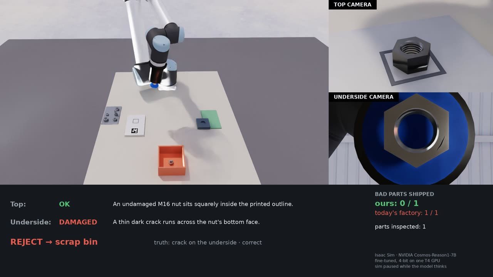
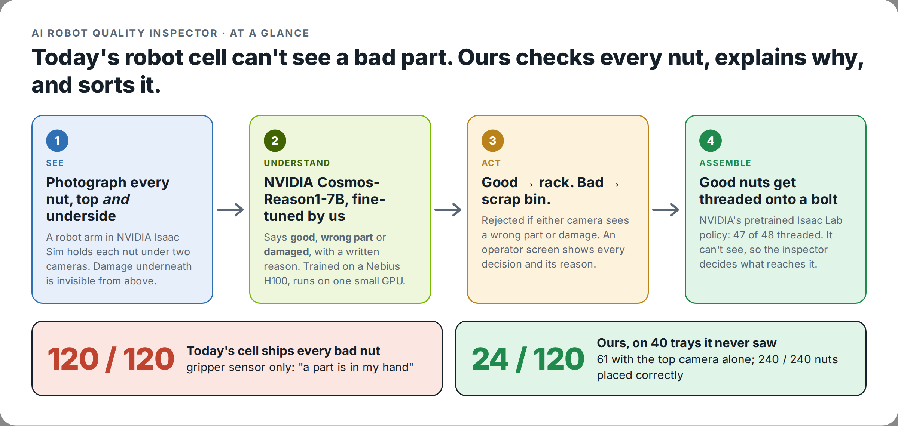
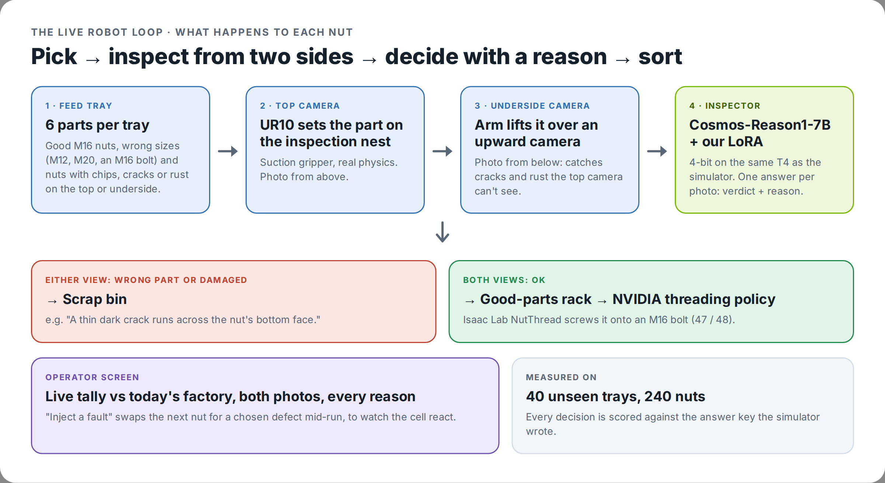
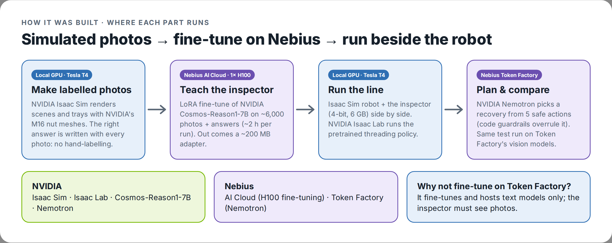
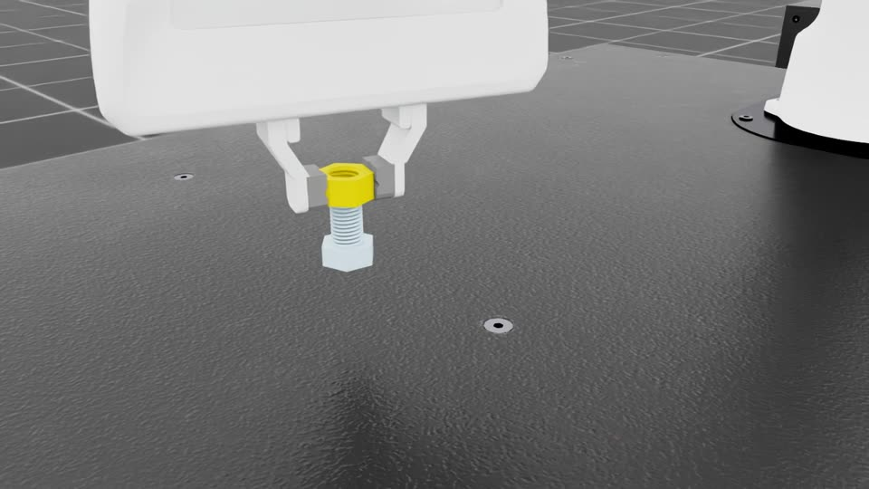

# Self-Healing Work Cell

**Apache-2.0** · Nebius x NVIDIA Global AI Hackathon 2026 · **Physical AI** track

A robot work cell in NVIDIA Isaac Sim that inspects every M16 nut **from the top and from
below** with a fine-tuned NVIDIA vision model, says **what is wrong and why**, and sorts it:
good nuts to the rack (and on to NVIDIA's threading policy), bad ones to the bin.



> **Headline (simulation):** on **40 trays the model never saw** (240 nuts, 120 bad), today's
> gripper-sensor-only cell ships all **120** bad nuts. Ours, with the fine-tuned NVIDIA
> **Cosmos-Reason1-7B** deciding live, ships **24** (61 with the top camera alone), and the arm put
> **240/240** nuts where it meant to. NVIDIA's pretrained Isaac Lab policy then threads
> **47/48** nuts onto an M16 bolt. Limitations are stated below, including the ones that hurt.

## In 30 seconds

- **What:** a robot cell that checks every nut from above *and* below with a fine-tuned NVIDIA
  vision model, says what's wrong in plain words, and sorts it: good nuts on to assembly, bad ones
  to the bin.
- **Why:** today's robot cells only know "a part is in my gripper", so a cracked, rusted or
  wrong-size nut gets shipped, and damage underneath is invisible even to a camera looking down.
- **How:** NVIDIA Isaac Sim makes labelled training photos for free → we fine-tune NVIDIA
  Cosmos-Reason1-7B on a Nebius AI Cloud H100 → it runs on one small GPU next to the simulated
  robot → NVIDIA's pretrained Isaac Lab policy threads the good nuts.



---

## The problem

An industrial pick-and-place cell is effectively blind. It has one sensor that matters: a
gripper switch reporting "something is / isn't between my fingers." A cracked, rusted or
wrong-size nut is still "something", so it ships. Damage on the underside is invisible even to a
camera that looks down at the part.

Adding real checks means hand-engineering a vision program per part number, per failure
mode. High-mix low-volume shops (job shops, machine tending) run hundreds of part numbers and
cannot pay for that.

## What we built

**One general inspector instead of N hand-written checks**, running next to the robot.

### The live robot loop



### How it was built, and where each part runs



- **The sorting line** (`isaac/run_sorting.py`): a UR10 with a suction gripper, real physics,
  NVIDIA's M16 nut / bolt meshes, trays of 6 parts with chips, cracks and rust **on the top or
  the underside**, and wrong sizes (M12, M20, an M16 bolt). Every tray comes from a seed, so the
  right answer is known: no hand-labelling.
- **The inspector** (`finetune/serve_verifier.py`): Cosmos-Reason1-7B with our LoRA adapter,
  compressed to 4-bit so it fits on one 15 GB T4 beside Isaac Sim, served over local HTTP.
- **The operator screen** (`dashboard/app.py`): live tally against today's factory, both
  photos, the model's reason for each verdict, every part so far, and **Inject a fault**: the
  next nut on the feed tray becomes the fault you pick, mid-run.
- **Threading** (`isaac/factory_eval.py`): NVIDIA's pretrained Isaac Lab
  `Isaac-Factory-NutThread-Direct-v0` policy. It is blind (gripper pose only, no camera), so it
  threads whatever it is handed; the inspector decides what reaches it.



## How Nebius and NVIDIA are used

| Component | What | Where it runs |
|---|---|---|
| Inspector | NVIDIA **Cosmos-Reason1-7B** + our LoRA adapter (51.5M trainable parameters) | fine-tuned on **Nebius AI Cloud** (1× H100); runs 4-bit on a local T4 |
| Recovery planner | NVIDIA **Nemotron**, tool calling, temperature 0 | **Nebius Token Factory** |
| Comparison verifiers | every per-token vision model on Token Factory, NVIDIA Nemotron-Nano-12B-v2-VL | **Nebius Token Factory**; Nemotron-VL on the Nebius VM |
| Simulation | NVIDIA **Isaac Sim 5.1** (scenes, UR10 sorting line), **Isaac Lab 2.3.2** (threading) | local GPU (Tesla T4) |
| Threading policy | NVIDIA's pretrained rl_games checkpoint for Factory NutThread | local GPU |

Why the fine-tune runs on AI Cloud and not Token Factory: Token Factory's fine-tuning and
custom-model hosting take text models only, and the inspector has to look at photos.

## Results

### The robot line, live (40 eval trays, 240 nuts, 120 bad, never trained on)

Same nuts, same photos, same verdicts; three ways of deciding (`eval/bench_sorting.py`):

| Policy | Bad nuts shipped | Good nuts scrapped |
|---|---|---|
| Today's cell (gripper sensor only) | 120 / 120 | 0 / 120 |
| Ours, top camera only | 61 / 120 | 13 / 120 |
| **Ours, top + underside (what the robot did)** | **24 / 120** | 19 / 120 |

- The underside camera caught **every** underside crack (12 of 13 shipped with the top camera
  alone → 0), all underside rust (8 → 0) and every wrong-size nut (M12 6 → 0, M20 8 → 0).
- Physical handling: **240 / 240** nuts ended where the robot meant to put them. 28 s per nut,
  ~21 s of it the model (two answers, 4-bit on a T4).
- What still ships: **small chips** (22 of 26). All 19 scrapped good nuts were called "wrong size".

### Threading

NVIDIA's pretrained NutThread policy, 16 environments × 3 rounds: **47 / 48 threaded (97.9%)**,
using the task's own physics success check.

### A plain CNN baseline (we checked, and it matters)

A ResNet-18 trained on the same 2,400 robot-cell photos is **about as accurate** as our inspector
on the 180 robot-cell dev parts (bad shipped 20/90 vs 19/90; good scrapped 11/90 vs 13/90). So we
don't claim the VLM is a better classifier for one fixed question. Its advantages are that it
**explains each decision in words** (shown on the operator screen), answers every checkpoint of
the cell with one model, and takes a new question in plain language.

We also tried to fix chips for free on the CNN first: 300 extra chip photos and a 2× zoom on the
nut. At an equal false-alarm rate neither helped (chips shipped 16/20 → 15–18/20), so we did not
spend on another fine-tune for it.

## Setup

| Part | Needs |
|---|---|
| Tests, scoring, reports, operator screen, model calls | Python 3.10+; a Nebius Token Factory key for live model calls only |
| Sorting line, scene rendering (`isaac/`) | Isaac Sim 5.1 and an NVIDIA RTX GPU (we used a 15 GB T4) |
| The inspector (`finetune/serve_verifier.py`) | a CUDA GPU with ~6 GB free; `torch`, `transformers`, `peft`, `bitsandbytes`; the base model downloads from Hugging Face |
| Threading (`isaac/factory_eval.py`) | Isaac Lab 2.3.2 (its own conda environment) |
| Fine-tuning (`finetune/`) | a GPU VM; we used one H100 80 GB on Nebius AI Cloud |

```bash
git clone https://github.com/Garvit-01/ai-robot-quality-inspector.git
cd ai-robot-quality-inspector
python3 -m venv .venv
.venv/bin/pip install -r requirements.txt
cp .env.example .env          # add your Nebius Token Factory key and model IDs
make test                     # no key or GPU needed
```

The LoRA adapter and the rendered data are not in the repo (size); `finetune/run_finetune.sh`
rebuilds them end to end (render → dataset → train on a GPU VM → score). See `finetune/README.md`.

## Run

```bash
# 1. The sorting line with the answer key (no model needed): tests the arm and cameras
~/isaacsim/python.sh isaac/run_sorting.py --trays 21000 --verifier oracle --out runs/sorting/try
#    add --gui to watch it in the Isaac Sim window

# 2. The full system: start the inspector, then the robot asks it about every nut
python finetune/serve_verifier.py --adapter finetune/adapter_A --quant 4bit     # waits on :8765
~/isaacsim/python.sh isaac/run_sorting.py --trays 21006 --out runs/sorting/live

# 3. The operator screen (http://localhost:8501), with fault injection
make dashboard

# 4. Score a run against today's factory
.venv/bin/python eval/bench_sorting.py runs/sorting/live

# 5. Film a run and build the overlay video
~/isaacsim/python.sh isaac/run_sorting.py --trays 21000 --out runs/sorting/film --film runs/sorting/film/frames
.venv/bin/python eval/film_overlay.py runs/sorting/film/frames --out runs/sorting/film/demo.mp4

# 6. NVIDIA's threading policy (Isaac Lab)
cd ~/IsaacLab && ./isaaclab.sh -p /path/to/repo/isaac/factory_eval.py \
    --task Isaac-Factory-NutThread-Direct-v0 --num_envs 16 --episodes 3 --headless --out runs/factory/nutthread
```

Tray seeds: 20000–20029 dev, 21000–21039 eval (the reported numbers), 22000–22199 and
23000–23099 training. `make help` lists everything else.

## The first stage: single-scene benchmark (4 checkpoints, Nemotron planner)

Before the robot line, we built and measured the inspector on staged single scenes.
At four checkpoints in the cycle, capture frames and ask a vision-language model one
question. It answers in strict JSON with a failure type drawn from a fixed enum. Hard
sensor rules are then fused on top — the gripper sensor always wins on "is something in
the hand," because a VLM should not overrule a switch.

| Checkpoint | Question |
|---|---|
| `CP_PRE_GRASP` | Right part, undamaged, roughly where expected? |
| `CP_POST_LIFT` | Is the part actually in the gripper? |
| `CP_POST_TRANSPORT` | Still in the gripper? If not, where did it go? |
| `CP_POST_PLACE` | Correctly seated in the fixture? |

If a checkpoint fails, **Nemotron** picks exactly one action from a whitelist of five
(continue, regrasp, reseat, reject to bin, stop and alert). It never moves the robot and never
emits a coordinate; at most it names a region ("carrier" or "table").

```
Camera ──▶ Verifier (VLM) ──▶ fuse with gripper signal ──▶ Nemotron picks 1 action ──▶ guardrails
```

In the benchmark each chosen action is scored against what should have happened. Executing
the actions with a physics-driven arm is being added (a sorting line in Isaac Sim).

**The guardrails are in code, not in the prompt.** A wrong or defective part can only ever
go to the reject bin; if the model picks anything else we override it and count the
override as a reported metric. Non-whitelisted tool, malformed arguments, no tool call, or
a timeout all collapse to `stop_and_alert`. Two failed recoveries forces a stop.

## Why fine-tune — the part that matters

No plant will stream floor camera frames to a third-party API every cycle. Data
sovereignty, latency, and per-cycle cost all forbid it. A small self-hosted specialist is
the only deployable form of this idea.

Isaac Sim makes testing that cheap: we *stage* each fault, so **the ground-truth label is
free by construction** — zero annotation. That turns the simulator into a training-data
factory and lets us run the same evaluation twice:

- **Tier 1** — hosted zero-shot vision model.
- **Tier 2** — [Cosmos-Reason1-7B](https://huggingface.co/nvidia/Cosmos-Reason1-7B)
  LoRA fine-tuned on 1,800 staged faults on a **Nebius AI Cloud** H100 VM (97 minutes), then
  compressed to 4-bit so it also runs on a 15 GB T4, the kind of GPU a plant could host.

Same held-out eval split, same prompt and same scorer for every model, so the columns are
comparable.

## Experimental conditions

| Cond | Name | Checks | On failure |
|---|---|---|---|
| A | no recovery | none | proceeds blindly |
| B | **industrial baseline** | gripper signal at post-lift and post-transport only | retry pick at original location 2x, then stop |
| C | **ours** | verifier at all 4 checkpoints + sensor fusion | Nemotron picks one whitelisted action, then guardrails |
| D | ablation | same verifier as C | fixed `failure_type → action` table, no LLM |

Condition D exists to answer the obvious objection: *why an LLM, when a switch statement
could pick from a five-item menu?* We will report that result honestly **even if D ties C.**

Condition B is the realistic industrial standard, not a straw man. Note that it detects
**zero** wrong-part, defective-part, and misaligned-seat faults — not because it is tuned
badly, but **by construction**: a gripper switch cannot perceive identity or alignment.

## Results

All on the **120 held-out scenes** (seeds 5000-5119): M16 nuts and their faults, never used for
training or for tuning prompts. 60 of them hold a bad part (wrong size, M16 bolt, chipped,
cracked, rusty, or seated crooked), 20 are clean, the rest are handling faults (displaced,
dropped, missed grasp). Same prompt, same two camera views, same parser and scorer for every row.

**The verifier: is it right about what's wrong?**

| Verifier | Correct | False alarms on clean parts | Faults missed |
|---|---|---|---|
| **Cosmos-Reason1-7B + our LoRA** (H100) | **94.2%** | 25% | **0%** |
| … same, 4-bit on a T4 | 93.3% | 20% | 2% |
| MiniMax-M3, zero-shot | 75.8% | 5% | 16% |
| Kimi-K3, zero-shot | 72.5% | 5% | 16% |
| Qwen3.8-27B, zero-shot | 66.7% | 0% | 22% |
| Gemma 3 27B, zero-shot | 48.3% | 0% | 52% |
| NVIDIA Nemotron-Nano-12B-v2-VL, zero-shot | 38.3% | 55% | 38% |
| NVIDIA Cosmos-Reason1-7B, zero-shot | 21.7% | 50% | 30% |

Untrained models cannot tell an M16 nut from an M12 or M20, and miss 4 mm chips; a second
prompt version aimed at exactly those changed nothing (0/6 wrong-size nuts, 0/4 chips on dev),
so it is a perception gap, not a wording one. Fine-tuning on
1,800 rendered scenes (51.5M trainable parameters, 0.6% of the model) closes it.

**The whole loop: how many bad parts reach the fixture?** (60 bad parts in the 120 scenes)

| Condition | Correct decisions | Bad parts shipped |
|---|---|---|
| A · no checks | 16.7% | 60 |
| B · industrial baseline (gripper sensor only) | 21.7% | 60 |
| C · ours, Gemma as verifier | 48.3% | 44 |
| **C · ours, fine-tuned Cosmos as verifier** | **95.8%** | **0** |

The cost: 5 of 20 clean nuts were flagged and sent to the bin.

**What didn't help:** the planner. Four Nemotron sizes (Nano 30B, Super 120B, Ultra 550B,
3.5-Lightning) made the same decision as a fixed lookup table (condition D) on all 180 scenes
(dev + held-out). The verifier's accuracy is what moves the result; we report that plainly.

## Limitations

Stated up front because they are the honest frame for every number here.

- **Simulation only.** Trained and evaluated on rendered scenes from the same simulator, camera
  and parts. On 275 real factory photos (MVTec AD, metal nuts and screws) the fine-tuned model
  calls almost everything defective (91-100% of good parts flagged), while untrained general
  models catch about half the real damage. Closing that gap needs real images in the training mix.
- **Small chips get through** (22 of 26 on the robot line), and neither more chip photos nor a
  zoomed view fixed it for a CNN baseline.
- **A plain CNN is about as accurate** on the sorting question; the case for the VLM is the
  explanations and the generality, not raw accuracy.
- **The sorting line acts on a fixed rule** (reject if either view says wrong or damaged). The
  Nemotron planner made the same choices as that rule on every scene we tested, so the robot
  uses the rule directly and logs nothing else.
- **The simulation pauses while the model thinks** (~10 s per photo on a T4, 4-bit).
- **Self-reported VLM confidence is poorly calibrated.** Logged, never used as a gate.

## Provenance

This project builds on an **existing** robot cell rather than starting from nothing, and the
split matters, so here it is explicitly.

**Pre-existing.** The UR5e + Robotiq 2F-85 pick-and-place cell — MoveIt2 configuration,
combined URDF, `apriltag_ros` perception off an Isaac Sim camera, and TF-based pose lookup —
was built between **July and September 2026**, beginning before this hackathon's submission
period opened on August 26, 2026. It lives in a separate repository,
[`ur5e-vision-pick-place`](https://github.com/Garvit-01/ur5e-vision-pick-place). Scene,
launch, and configuration files reused here are noted where they appear.

**New for this hackathon**, all of it after October 10, 2026: the fault staging and
ground-truth generation (cubes, then NVIDIA's M16 nuts and bolts with chips, cracks and rust),
the VLM verifier and its sensor-fusion rules, the recovery planner and the code-level
guardrails, the LoRA fine-tuning pipeline, the evaluation harness, the UR10 sorting line with top and underside inspection, the operator screen, and the threading evaluation. The dated commit history of both repositories
reflects this.
